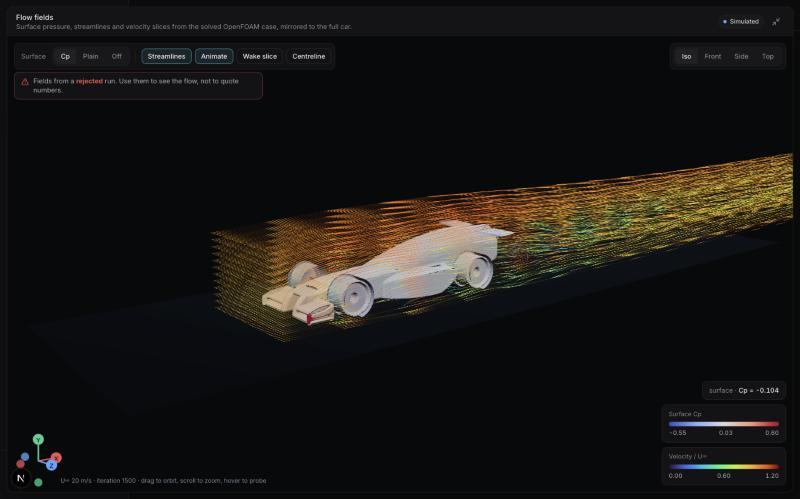
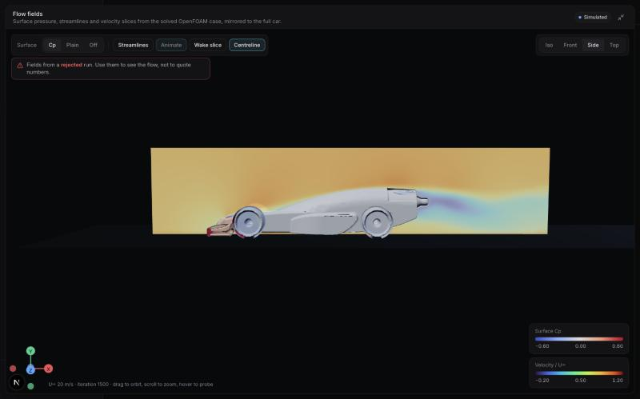

# P3-04 — Flow-field export and the Virtual Wind Tunnel viewer

**Date:** 2026-10-30 · **Source run:** `orbit_baseline_20ms` (rejected, so the viewer shows a banner saying so).

## What was built
- `src/daedalus/viz.py` reads the reconstructed case with PyVista/VTK (`POpenFOAMReader`) and writes `viz/viz.json` plus `viz/viz.bin`:
  - **surface:** car patches, triangulated, with Cp = p / (0.5 U²) per vertex.
  - **streamlines:** 192 seeds on a rake 30 mm ahead of the nose, forward RK integration through U, coloured by |U|/U∞.
  - **wake:** an x-normal slice 15 mm behind the car, coloured by Ux/U∞.
  - **centreline:** a slice on the symmetry plane, coloured by Ux/U∞.
  - Every layer except the centreline is mirrored about y = 0, with mirrored triangles re-wound so normals stay outward.
- `daedalus cfd viz CASE` runs the export by hand. `daedalus cfd run` now runs it automatically after a successful solve, and an export failure never masks the solver result.
- API: `GET /v1/cfd/runs/{id}/viz.json` and `/viz.bin`; the run list now reports `has_viz`.
- Cockpit, `Simulate → Flow fields`, built with R3F:
  - Cp surface (diverging map centred on 0), animated streamlines (GPU shader pulses), wake and centreline slices.
  - Iso, front, side and top cameras; hover probe that reads values; legends; full-screen mode; WebGL context-loss recovery.
- The browser maps typed-array views straight onto one binary buffer, so the arrays need no parsing.

## Measurements
- Export of the 782k-cell case: **5.3 s wall, 1.5 s CPU**, 9.7 MB.
- Layer sizes: surface 199k vertices / 386k triangles; streamlines 55.6k points, mirrored; centreline 17.7k vertices.

## Checks
- `tests/test_viz.py`: mirror winding, 4-byte buffer alignment, polyline flattening.
- `tests/test_api_engineering.py`: viz endpoints and `has_viz`.
- `src/lib/colormap.test.ts`: colormap stops, neutral centre, interleaving.
- pytest 70 pass, mypy --strict clean, tsc and eslint clean.

## Screens

## Observations
- Nose stagnation shows as red Cp. Flow accelerates over the top of the body, and a long low-velocity wake trails behind the cartridge.
- The fields come from the last iteration of an **unsteady, rejected** run. They are for understanding the flow, not for quoting numbers.
